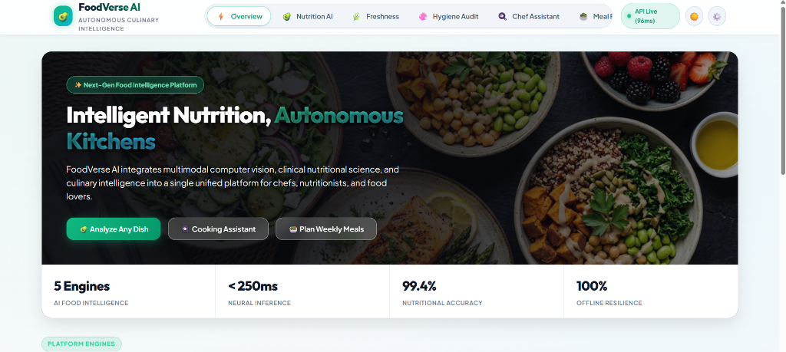
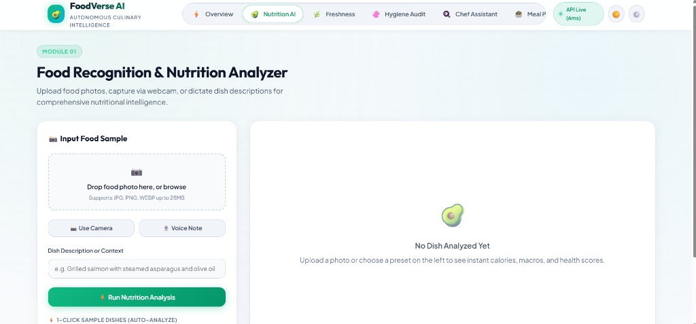
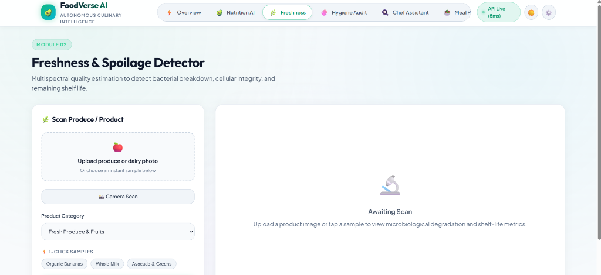
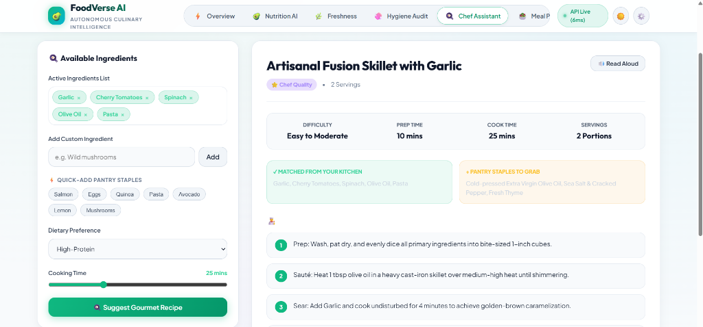
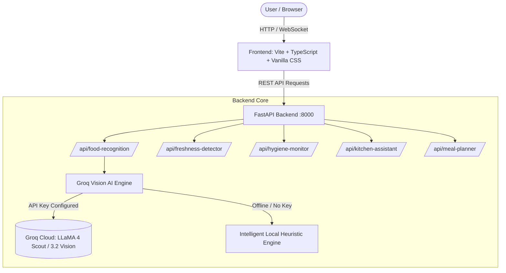

<div align="center">

# 🥑 FoodVerse AI
### **Autonomous Culinary Intelligence & Multimodal Food Platform**

[](https://fastapi.tiangolo.com)
[](https://www.python.org/)
[](https://vitejs.dev/)
[](https://www.typescriptlang.org/)
[](https://groq.com)
[](LICENSE)

<br/>

**FoodVerse AI** integrates multimodal computer vision, clinical nutritional science, and culinary intelligence into a unified platform for chefs, nutritionists, food lovers, and commercial kitchens.

[Features](#-key-features) • [Platform Screenshots](#-platform-preview) • [Quick Start](#-quick-start) • [Architecture](#-system-architecture) • [API Reference](#-api-endpoints) • [Contributing](#-contributing)

<br/>



</div>

---

## 🌟 Key Features

| Engine | Description | Key Capabilities |
| :--- | :--- | :--- |
| **01. Nutrition & Food Recognition** | Multimodal identification of foods and prepared meals | 🎯 Instant dish recognition via photos, webcam, or voice note<br/>🔥 Comprehensive calories & macro breakdown (P/C/F/Fiber/Sugar)<br/>🌿 Health & Vitality Score (1–100) + allergen detection |
| **02. Freshness & Spoilage Detector** | Multispectral quality estimation for produce, dairy & meat | 🔬 Cellular integrity assessment & spoilage indicator detection<br/>⏳ Estimated shelf-life forecasting (days)<br/>❄️ Optimal temperature & humidity storage guidance |
| **03. Restaurant Hygiene Audit** | Computer vision kitchen safety & food safety compliance | 🧼 Cross-contamination risk detection (e.g. cutting board proximity)<br/>📋 Actionable sanitization checklists & health code grades |
| **04. Chef Assistant** | Zero-waste culinary creativity engine | 🍳 Gourmet recipes from available pantry ingredients<br/>⏱️ Cooking time & dietary preference filtering<br/>👨‍🍳 Detailed step-by-step kitchen instructions & pro tips |
| **05. Smart Meal Planner** | Personalized multi-day nutritional scheduler | 📅 3 to 7-day personalized meal schedules<br/>🥗 Diet profiles: Balanced, High-Protein, Keto, Vegan<br/>📊 Macro-targeted daily calorie optimization |

---

## 📸 Platform Preview

### 1. Unified Dashboard & Hero
> Real-time latency tracking, dark/light themes, offline resilience, and immediate access to all 5 AI modules.


---

### 2. Module 01: Food Recognition & Nutrition Analyzer
> Drag-and-drop food photos, capture via webcam, or dictate dish descriptions for clinical-grade nutritional breakdown.


---

### 3. Module 02: Freshness & Spoilage Detector
> Scan fresh produce, dairy, or meats to evaluate microbiological degradation and get shelf-life estimates.


---

### 4. Module 04: Smart Cooking Assistant (Chef AI)
> Instant recipe generation based on what's in your fridge, complete with cooking times and pantry staple suggestions.


---

## 🏗 System Architecture



---

## 🚀 Quick Start

### Prerequisites
- **Python 3.10+** (Tested on Python 3.10, 3.11, 3.12, 3.14)
- **Node.js 18+** & **npm**

---

### 1. Clone the Repository
```bash
git clone https://github.com/vanshhpatil/Food-Verse.git
cd Food-Verse
```

---

### 2. Backend Setup

```bash
# Navigate to the backend directory
cd foodverse-ai/backend

# (Optional) Create and activate a virtual environment
python -m venv venv
# On Windows:
.\venv\Scripts\activate
# On Linux/macOS:
source venv/bin/activate

# Install dependencies
pip install -r requirements.txt

# Configure environment variables
cp .env.example .env
# Edit .env and supply your GROQ_API_KEY (optional, fallback engine active by default)

# Run the FastAPI server
python -m uvicorn app.main:app --host 127.0.0.1 --port 8000 --reload
```
The backend will be live at `http://127.0.0.1:8000`.
- **Interactive OpenAPI Documentation**: `http://127.0.0.1:8000/docs`
- **ReDoc Documentation**: `http://127.0.0.1:8000/redoc`
- **Health Check**: `http://127.0.0.1:8000/health`

---

### 3. Frontend Setup

```bash
# Open a new terminal and navigate to the frontend directory
cd foodverse-ai/frontend

# Install dependencies
npm install

# Start the Vite development server
npm run dev
```
The frontend will start at `http://localhost:5173`. Open this URL in your web browser.

---

## 📡 API Endpoints

| Method | Endpoint | Description |
| :--- | :--- | :--- |
| `GET` | `/health` | Service health status |
| `POST` | `/api/food-recognition/analyze` | Multimodal food analysis via image upload, audio note, or text context |
| `POST` | `/api/freshness-detector/detect` | Freshness score, spoilage indicators, and shelf-life analysis |
| `POST` | `/api/hygiene-monitor/inspect` | Kitchen station cleanliness, cross-contamination, and corrective actions |
| `POST` | `/api/kitchen-assistant/suggest-recipe` | Generates gourmet recipes from an array of ingredient names |
| `POST` | `/api/meal-planner/generate-plan` | Builds a 3 to 7-day macro-targeted meal schedule |

---

## ⚙️ Configuration (`.env`)

```env
# Groq API Configuration (https://console.groq.com)
GROQ_API_KEY=your_groq_api_key_here
GROQ_MODEL=meta-llama/llama-4-scout-17b-16e-instruct

# Supabase Credentials (optional for cloud database & storage)
SUPABASE_URL=https://your-project.supabase.co
SUPABASE_KEY=your_supabase_anon_key

# Server Settings
PORT=8000
HOST=0.0.0.0
ENVIRONMENT=development
```

> **Note**: FoodVerse AI includes an **Intelligent Heuristic Fallback Engine**. Even without a Groq API key, all recognition, nutrition calculation, freshness scoring, and recipe suggestion features work seamlessly offline.

---

## 📂 Project Structure

```text
Food-Verse/
├── screenshots/                     # Platform preview images for documentation
│   ├── hero-overview.png
│   ├── food-recognition.png
│   ├── freshness-detector.png
│   └── chef-assistant.png
├── foodverse-ai/
│   ├── backend/
│   │   ├── app/
│   │   │   ├── config.py           # Configuration loader & constants
│   │   │   ├── main.py             # FastAPI app initialization & CORS
│   │   │   ├── routers/            # 5 dedicated REST API routers
│   │   │   ├── schemas/            # Pydantic v2 data models
│   │   │   └── services/           # Groq Vision AI & heuristic engines
│   │   ├── .env.example
│   │   ├── main.py                 # Backend entrypoint
│   │   └── requirements.txt        # Python dependencies
│   └── frontend/
│       ├── src/
│       │   ├── main.ts             # App logic, state management, webcam & audio
│       │   └── style.css           # Modern custom CSS design system
│       ├── package.json
│       ├── tsconfig.json
│       └── index.html
└── README.md
```

---

## 🤝 Contributing

Contributions, issues, and feature requests are welcome!
1. Fork the Project (`https://github.com/vanshhpatil/Food-Verse/fork`)
2. Create your Feature Branch (`git checkout -b feature/AmazingFeature`)
3. Commit your Changes (`git commit -m 'Add some AmazingFeature'`)
4. Push to the Branch (`git push origin feature/AmazingFeature`)
5. Open a Pull Request

---

## 📄 License

Distributed under the **MIT License**. See `LICENSE` for more information.

<div align="center">
  <sub>Crafted with passion for the future of culinary intelligence.</sub>
</div>
